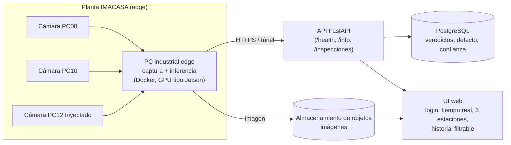

# Servicio mock IMACASA – PC12 Inyectado (Persona 4)

## Resumen del proyecto

**Reto:** inspección visual de defectos asistida por IA en la línea de machetes de IMACASA. Nuestra estación es **PC12 Inyectado**. Este repo contiene la parte de infraestructura (Persona 4): servicio mock en Docker, túnel público y arquitectura.

**Qué se hizo**
1. **API mock** (FastAPI, `app/main.py`) con solo dos endpoints: `GET /health` (abierto, 200) y `GET /info` (HTTP Basic: 401 sin credenciales, 200 + JSON con equipo, estación, versión y timestamp).
2. **Docker**: `Dockerfile` (Python 3.11 slim, usuario sin privilegios, healthcheck) y `docker-compose.yml`. El contenedor se construyó y probó en GitHub Codespaces.
3. **Túnel público** con ngrok y dominio estático: `https://finalize-ruckus-spirited.ngrok-free.dev`. La URL no cambia entre reinicios.
4. **Arquitectura** (`docs/arquitectura.png` y `docs/arquitectura.md`): flujo cámara → captura → inferencia en edge → túnel → API → PostgreSQL / almacenamiento de imágenes → UI web, para las 3 estaciones. La inferencia va en edge porque los modelos elegidos (EfficientAD-S, YOLO26-seg) son ligeros.
5. **Evidencias** (`docs/evidencias/`): salida de `docker build/run/ps` y de los 3 `curl` contra el contenedor y contra la URL pública (200, 401, 200 + JSON).

**Dónde está cada cosa para el reporte**

| Sección del reporte | Archivos |
|---|---|
| 2. Arquitectura y servicios | `docs/arquitectura.png`, `docs/arquitectura.md` |
| 5. Docker + túnel | `Dockerfile`, apartado "Justificación" de este README, `docs/evidencias/` |
| Portada | URL del túnel (arriba) y credenciales de prueba (las pasa Persona 4; también aparecen en `docs/evidencias/tunel-curl.txt`) |

**Entregas del resto del equipo** (carpeta `equipo/`, copiadas tal como las pasaron). Las dudas sobre cifras y lo que falta alinear entre secciones están en [equipo/ACLARACIONES.md](equipo/ACLARACIONES.md).

| Carpeta | Contenido |
|---|---|
| `equipo/enunciado/` | PDF del reto (requisitos y rúbrica) |
| `equipo/seccion3-modelos/` | Sección 3: investigación de modelos preentrenados |
| `equipo/seccion4-defectos/` | Sección 4: análisis de defectos, cantidad de imágenes y protocolo de captura |
| `equipo/captura/` | Propuesta de captura en planta: texto (`seccion-captura-pc12.md`) y figuras A, B y C (`index.html` las muestra juntas) |
| `equipo/ui/` | Prototipo de UI (`prototipo-ui-pc12.html`; se abre en el navegador) |

**Notas**
- En la laptop de Persona 4 Docker Desktop no arranca (WSL2), así que el día de la clase la API corre con `run-local.ps1` (Python) detrás del mismo túnel. El código y las respuestas son los mismos que en el contenedor.
- El avance y los pendientes están en `ESTADO.md`.

---

Servicio en Docker con dos endpoints, expuesto por túnel público (ngrok).

| Endpoint | Auth | Respuesta |
|---|---|---|
| `GET /health` | No | `200 {"status": "ok"}` |
| `GET /info` | HTTP Basic | sin credenciales → `401`; con credenciales → `200 {"equipo","estacion","version","timestamp"}` |

## 1. Preparar
1. Instalar **Docker Desktop**.
2. ngrok: `ngrok config add-authtoken TU_TOKEN` (una sola vez). Dominio estático: `finalize-ruckus-spirited.ngrok-free.dev`.
3. `cp .env.example .env` y llenar `API_PASSWORD` (el `.env` real no se sube al repo).

## 2. Ejecutar (comandos para el reporte)
```bash
docker compose up -d --build
ngrok http 8000 --url=finalize-ruckus-spirited.ngrok-free.dev
```
Plan B sin Docker: `.\run-local.ps1` + el mismo comando de ngrok.
Solo la API, sin compose:
```bash
docker build -t imacasa-mock:1.0.0 .
docker run -d --name imacasa-api -p 8000:8000 --env-file .env imacasa-mock:1.0.0
```

## 3. Pruebas (capturas para el reporte)
```bash
curl -i https://finalize-ruckus-spirited.ngrok-free.dev/health
curl -i https://finalize-ruckus-spirited.ngrok-free.dev/info
curl -i -u imacasa:TU-CLAVE https://finalize-ruckus-spirited.ngrok-free.dev/info
```
Esperado: 200, 401, 200 + JSON. Para la portada: **URL** `https://finalize-ruckus-spirited.ngrok-free.dev` y **credenciales** `-u imacasa:TU-CLAVE`.

## 4. Justificación (texto para el reporte)
**Esquema de autenticación – HTTP Basic sobre HTTPS.** Es el estándar más simple (RFC 7617) que el profesor puede probar con `curl -u usuario:clave`; el túnel termina TLS, así que las credenciales viajan cifradas. La comparación usa `secrets.compare_digest` (tiempo constante) y las credenciales se inyectan por variables de entorno, no están en la imagen. En producción se migraría a tokens JWT/OAuth2 con usuarios por rol (operador, supervisor de calidad).

**Túnel – ngrok con dominio estático.** El dominio gratuito de ngrok es fijo: la URL impresa en la portada del PDF sigue siendo válida aunque se reinicie el contenedor el día de la clase. Se descartó el *quick tunnel* de Cloudflare (`trycloudflare.com`) porque genera una URL aleatoria nueva en cada reinicio. Ngrok además da HTTPS automático y un panel de inspección (`localhost:4040`) útil para depurar en vivo. En producción en planta se usaría Cloudflare Tunnel con dominio propio + Cloudflare Access.

**Docker.** Imagen `python:3.11-slim`, usuario sin privilegios, `HEALTHCHECK` sobre `/health`, `restart: unless-stopped` para que se recupere sola. FastAPI + Uvicorn: ligero y el mismo stack que serviría la inferencia real.

## 5. Diagrama de arquitectura (borrador, Mermaid)

Confirmado con la sección 3 (EfficientAD-S 2.2 ms, YOLO26-seg n/s): inferencia en **edge**. Diagrama final: `docs/arquitectura.png` (fuente `docs/arquitectura.svg`) y texto en `docs/arquitectura.md`.

## 6. Checklist día de la clase
- [ ] Laptop conectada a corriente, sin suspensión.
- [ ] `docker compose up -d` 15 min antes; probar los 3 `curl`.
- [ ] No cambiar la clave después de entregar el PDF.
