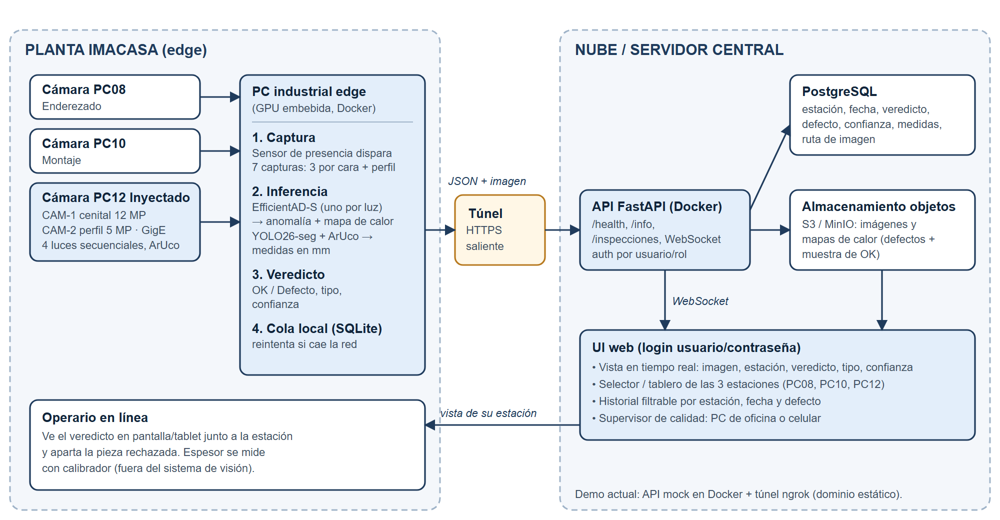

# 2. Arquitectura y servicios (texto para el reporte)

**Figura 2.1.** Flujo completo cámara → captura → envío → inferencia → base de datos → UI, pensado para las tres estaciones (PC08, PC10, PC12).

## Decisión principal: inferencia en edge
La inferencia corre en un PC industrial con GPU embebida junto a la línea, no en la nube. Hay tres razones:
1. **Los modelos son ligeros.** EfficientAD-S reporta 2.2 ms por imagen y YOLO26-seg n/s tiene 2.7–10.4 M parámetros (sección 3). Caben en hardware edge con margen, aunque la latencia ahí sea varias veces mayor que en una GPU de escritorio.
2. **Ancho de banda.** Una cámara de varios megapíxeles por estación genera mucho tráfico. Al decidir en la planta, solo se suben el veredicto (JSON), las imágenes con defecto y una muestra de piezas OK para auditoría.
3. **Continuidad.** Si se cae internet, la línea sigue inspeccionando. Los resultados se guardan en una cola local (SQLite) y se sincronizan al volver la conexión.

## Servicios por pieza

| Pieza | Servicio propuesto | Por qué |
|---|---|---|
| Captura | Cabina con dos cámaras de área GigE de obturador global (CAM-1 cenital de 12 MP y CAM-2 de perfil de 5 MP) y cuatro luces. Un sensor de presencia inicia la secuencia y un controlador enciende una luz por captura: 3 por cara con CAM-1 y 1 de perfil con CAM-2, 7 por machete. El detalle está en la propuesta de captura. | Cada tipo de defecto necesita una luz distinta. El obturador global permite pulsos de luz de ~15 ms. GigE admite cables de hasta 100 m hasta el equipo edge. |
| Inferencia | PC edge con GPU embebida y contenedores Docker: EfficientAD-S (Anomalib, una instancia por luz: L1, L2 y L3), YOLO26-seg + OpenCV/ArUco | Baja latencia, sin depender de la red. Docker permite usar la misma imagen en las 3 estaciones. |
| Envío | HTTPS saliente mediante túnel (demo: ngrok con dominio estático; producción: Cloudflare Tunnel con dominio propio) | No se abren puertos en el firewall de la planta y el tráfico va cifrado con TLS. |
| API | FastAPI en Docker (`/inspecciones`, WebSocket para tiempo real) | El mismo stack Python que los modelos, ligero y con documentación automática. |
| Base de datos | PostgreSQL administrado | Datos relacionales: estación, fecha, defecto y confianza. Los índices hacen rápido el historial filtrable que pide la UI. |
| Imágenes | Almacenamiento de objetos S3 (o MinIO si se aloja en planta) | Barato para guardar mucho volumen. En la base de datos solo se guarda la ruta de cada imagen. Las imágenes guardadas sirven para reentrenar el modelo (fase 2). |
| UI | Web con login usuario/contraseña, conectada por WebSocket | Funciona en la tablet del operario y en la PC o el celular del supervisor sin instalar nada. |

## Demo de este checkpoint
API mock en Docker con `GET /health` (abierto) y `GET /info` (HTTP Basic), expuesta con ngrok. La justificación y la evidencia están en la sección 5.
